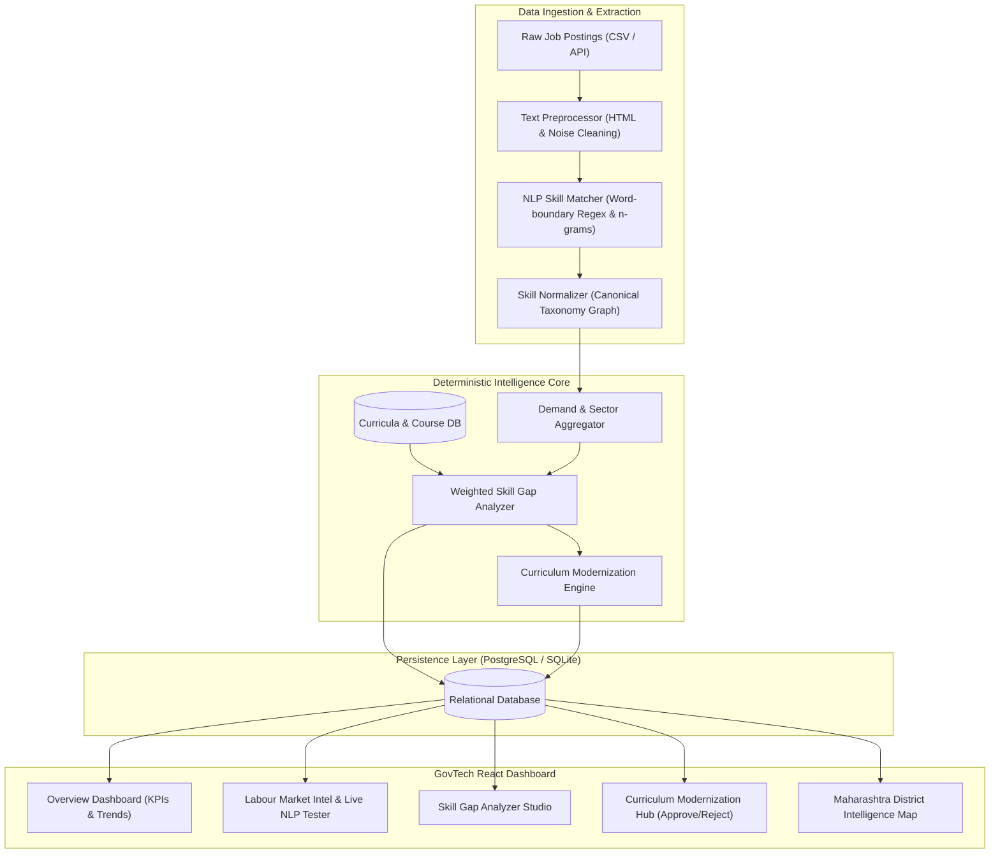
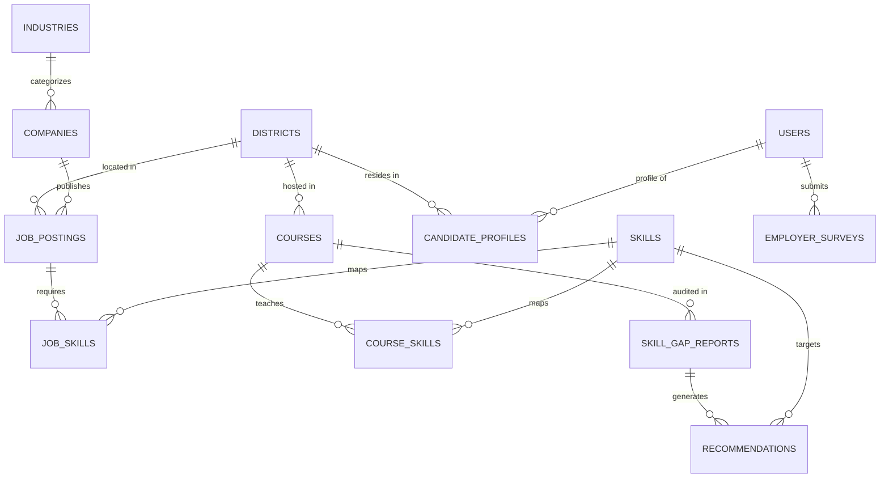

# SkillPulse – Workforce Intelligence Platform

<p align="center">
  <strong>AI-Powered Labour Market Intelligence & Curriculum Alignment Platform</strong><br>
  <em>Addressing SIH Problem Statement 26134: Challenges in aligning skill development programs with industry requirements and emerging job market demands.</em>
</p>

<p align="center">
  
  
  
  
  
</p>

---

## 1. Executive Summary & Problem Context

In traditional vocational and educational ecosystems (such as ITIs, polytechnics, and state skill universities), curriculum revisions occur on multi-year cycles. Conversely, industry skill requirements evolve on quarterly cycles driven by advancements in artificial intelligence, cloud architectures, industrial automation, and modern manufacturing.

This lag creates a structural employability deficit:
1. **Curriculum Lag:** Syllabi teach outdated tooling while employers search for modern competencies.
2. **The "Black Box" Gap:** Training institutions lack mathematical, explainable metrics identifying *which exact topics* are missing from their courses.
3. **Spatial Demand Mismatch:** Industrial demand varies dramatically by district (e.g., Automotive & AI in Pune vs. Multimodal Logistics in Nagpur vs. Precision Tooling in Nashik). State planners lack continuous, localized telemetry to allocate training funds effectively.

### The Solution: SkillPulse
**SkillPulse** is an end-to-end evidence-based workforce intelligence system. It continuously ingests real-world job demand signals, extracts skills via NLP, performs deterministic weighted competency gap analysis against existing syllabi, and generates actionable, modular curriculum modernizations.

$$\text{Industry Demand Postings} \longrightarrow \text{NLP Skill Extraction} \longrightarrow \text{Weighted Gap Analysis} \longrightarrow \text{Curriculum Modernization} \longrightarrow \text{District Telemetry}$$

---

## 2. High-Level System Architecture



---

## 3. Entity-Relationship (ER) Architecture

The platform uses a relational data model with 15 interconnected entities supporting all stakeholders:



---

## 4. Key Functional Modules

### Module 1: Labour Market Intelligence & CSV Ingestion (`PRD FR-101 – FR-107`)
* Ingests structured and unstructured job records via CSV upload or REST API.
* Normalizes district geographical attributes across all 36 Maharashtra districts.
* Retains raw job descriptions for auditability and NLP traceability.

### Module 2: NLP Entity Preprocessing & Taxonomy Normalization (`PRD Section 6.4`)
* **Text Preprocessor:** Strips HTML noise, standardizes unicode bullets, and segments job postings into `requirements`, `responsibilities`, and `preferred` sections.
* **Skill Matcher:** Word-boundary phrase matching prevents false positives (e.g. `C` vs `CSS`, `Java` vs `JavaScript`).
* **Canonical Normalization:** Maps variations, acronyms, and aliases to standard taxonomy nodes (`py` $\to$ `Python`, `k8s` $\to$ `Kubernetes`, `vmc` $\to$ `CNC Machining`, `tig welding` $\to$ `Welding`).

### Module 3: Deterministic Weighted Skill Gap Analysis (`PRD Module 2`)
* Evaluates competencies required by live industry postings against course syllabi.
* Computes the mathematical **Skill Alignment Score**:
  $$\text{Skill Alignment Score} = \left(\frac{\sum \text{Weighted Covered Skills}}{\sum \text{Total Weighted Required Skills}}\right) \times 100$$
* Categorizes every required competency into **Covered** (100% weight), **Partially Covered** (50% weight), or **Missing** (0% weight).

### Module 4: Curriculum Recommendation Engine (`PRD Module 3`)
* Transforms missing competencies into modular syllabus upgrade units.
* Formulates specific measurable **Learning Outcomes** (Bloom's taxonomy), practical workshop/lab exercises, priority levels (`HIGH`, `MEDIUM`, `LOW`), and evidence-backed rationale.
* Includes state administrator approval workflow (`PENDING` $\to$ `APPROVED` or `REJECTED`).

### Module 5: Maharashtra District Intelligence (`PRD Module 4`)
* Ranks and visualizes spatial demand clusters (Pune, Mumbai, Nagpur, Nashik, Chhatrapati Sambhajinagar).
* Highlights localized skill deficits to prevent course oversupply and guide public fund allocation.

---

## 5. Technology Stack

| Layer | Technology | Purpose |
|---|---|---|
| **Backend Framework** | Python 3.12+, FastAPI | Asynchronous REST API, high performance |
| **Data Validation** | Pydantic v2, Pydantic-Settings | Request/response schema contracts |
| **Persistence** | SQLAlchemy 2.0 (PostgreSQL / SQLite) | ORM models, migrations, relationship mapping |
| **NLP & Extraction** | Python Regex, n-grams, Difflib, spaCy | Noise cleaning, phrase matching, fuzzy aliases |
| **Frontend UI** | React 19, TypeScript, Vite | Fast, modern client application |
| **UI Styling** | Custom GovTech Design System (CSS3) | Accessible, responsive government dashboard |
| **Icons & Visuals** | Lucide-React | Scalable UI icons |
| **Package Tooling** | `uv` (Python), `npm` (Node.js) | Lightning-fast dependency management |

---

## 6. Project Structure

```text
SkillPulse/
├── backend/
│   ├── app/
│   │   ├── main.py                  # Lifespan startup, CORS, healthcheck, route mounting
│   │   ├── core/
│   │   │   └── config.py            # Environment settings (DATABASE_URL, API_V1_STR)
│   │   ├── database/
│   │   │   ├── session.py           # SQLAlchemy engine & session factory
│   │   │   └── seed.py              # Pre-populates Maharashtra districts, skills, courses
│   │   ├── models/                  # 15 ORM models (location, skill, job, course, gap_analysis, stakeholder)
│   │   ├── schemas/                 # Pydantic v2 request/response schemas
│   │   ├── ml/
│   │   │   ├── nlp_pipeline.py      # Text preprocessing & section segmentation
│   │   │   └── skill_matcher.py     # Word-boundary phrase extractor
│   │   ├── services/
│   │   │   ├── job_ingestion.py     # CSV parsing & skill linking
│   │   │   ├── skill_normalization.py# Taxonomy synonym dictionary
│   │   │   ├── gap_analysis.py      # Deterministic weighted alignment engine
│   │   │   ├── curriculum_engine.py # Actionable syllabus upgrade generator
│   │   │   └── analytics.py         # Demand frequency & district telemetry
│   │   └── api/v1/                  # REST endpoints (jobs, skills, courses, districts, analytics, analysis, recs)
│   ├── tests/
│   │   ├── test_step2.py            # Database, seeding, and CSV ingestion tests
│   │   ├── test_nlp_pipeline.py     # NLP preprocessing, extraction & analytics tests
│   │   └── test_step4_gap_analysis.py# Gap analysis & recommendation engine tests
│   └── pyproject.toml
│
├── frontend/
│   ├── src/
│   │   ├── components/
│   │   │   ├── Navbar.jsx           # Maharashtra branding, live connection pill, tab navigation
│   │   │   ├── OverviewTab.jsx      # High-level KPIs, demand progress bars, sector distributions
│   │   │   ├── LabourMarketTab.jsx  # Job directory & Live NLP Extraction Playground
│   │   │   ├── SkillGapTab.jsx      # Course vs. role audit matrix & visual alignment gauge
│   │   │   ├── ModernizationTab.jsx # Syllabus units with 1-click Approve/Reject actions
│   │   │   └── DistrictIntelTab.jsx # Maharashtra spatial demand & shortage advisories
│   │   ├── services/
│   │   │   └── api.js               # Centralized API client
│   │   ├── App.jsx                  # Main application container & status poller
│   │   └── App.css                  # Professional GovTech responsive styling
│   ├── package.json
│   └── vite.config.js
│
├── datasets/
│   └── sample_jobs_maharashtra.csv  # Verified Maharashtra job postings dataset
├── PRD/
│   └── PRD.txt                      # Complete Product Requirements Document
├── .gitignore
└── README.md
```

---

## 7. Local Setup & Quick Start

### Prerequisites
* **Python:** 3.12 or higher (`uv` recommended)
* **Node.js:** v18 or higher with `npm`
* **Git:** Installed and available in PATH

### 1. Clone the Repository
```bash
git clone https://github.com/LIKHIT123498/SkillPulse-Workforce-Intelligence-Platform.git
cd SkillPulse-Workforce-Intelligence-Platform
```

### 2. Backend Setup (FastAPI)
```powershell
cd backend

# Option A: Using uv (Recommended)
uv run python -m app.database.seed
$env:PYTHONPATH="."
uv run uvicorn app.main:app --reload --port 8000

# Option B: Using standard Python venv
python -m venv .venv
.venv\Scripts\activate
pip install -r requirements.txt   # or uv pip install
python -m app.database.seed
uvicorn app.main:app --reload --port 8000
```
* Interactive Swagger API Documentation: [http://localhost:8000/docs](http://localhost:8000/docs)
* Healthcheck Endpoint: [http://localhost:8000/api/v1/health](http://localhost:8000/api/v1/health)

### 3. Frontend Setup (React + Vite)
```powershell
cd frontend
npm install
npm run dev
```
* Web Application UI: [http://localhost:5173](http://localhost:5173)

---

## 8. REST API Reference

| Method | Endpoint | Description |
|---|---|---|
| `GET` | `/api/v1/health` | Live system and database connectivity healthcheck |
| `GET` | `/api/v1/analytics/overview` | Platform-level KPIs (jobs, unique skills, district coverage) |
| `GET` | `/api/v1/analytics/skills` | Skill-demand counts categorized by sector |
| `GET` | `/api/v1/analytics/districts` | Spatial demand distribution across Maharashtra districts |
| `POST` | `/api/v1/jobs/import` | Upload CSV dataset to ingest job postings |
| `GET` | `/api/v1/jobs` | Retrieve paginated job postings (filter by `sector`, `district_id`) |
| `GET` | `/api/v1/skills` | Retrieve canonical skill taxonomy |
| `POST` | `/api/v1/skills/extract` | Extract canonical skills on-the-fly from unstructured text |
| `GET` | `/api/v1/skills/top-demanded` | Retrieve highest demand skills across all postings |
| `GET` | `/api/v1/courses` | Retrieve vocational/ITI courses with covered competencies |
| `POST` | `/api/v1/courses` | Create new course and map taught competencies |
| `POST` | `/api/v1/analysis/skill-gap` | Compute weighted skill alignment score for course vs. role |
| `GET` | `/api/v1/analysis/{id}` | Retrieve historical skill gap audit report |
| `GET` | `/api/v1/recommendations` | Retrieve modernization proposals (filter by `status`, `course_id`) |
| `PATCH`| `/api/v1/recommendations/{id}`| Update proposal approval status (`PENDING`, `APPROVED`, `REJECTED`) |

---

## 9. Automated Test Suite

SkillPulse includes automated test suites covering every major functional module:

```powershell
cd backend
$env:PYTHONPATH="."

# 1. Run Data Layer & Ingestion Tests
uv run python tests/test_step2.py

# 2. Run NLP Preprocessing & Analytics Tests
uv run python tests/test_nlp_pipeline.py

# 3. Run Skill Gap & Recommendation Engine Tests
uv run python tests/test_step4_gap_analysis.py
```

**Test Verification Summary:**
```text
✓ Health check passed (/api/v1/health -> database connected)
✓ Districts verified: 36 Maharashtra districts seeded
✓ Skills verified: 28 skills mapped
✓ Courses verified: 4 vocational courses seeded
✓ CSV Ingestion verified: 10/10 jobs imported from sample dataset
✓ Text Preprocessor: HTML & formatting noise cleaned
✓ Skill Normalizer: Synonyms, abbreviations & fuzzy matches verified
✓ Skill Matcher: Extracted 7 canonical competencies from unstructured descriptions
✓ Skill Gap Analysis: Computed deterministic weighted score (25.0% for COPA vs. Python Developer)
✓ Curriculum Modernizer: Generated 3 actionable syllabus units with learning outcomes & labs
✓ Approval Workflow: PATCH /api/v1/recommendations/{id} updated status to APPROVED

🎉 ALL TEST SUITES PASSING (100% SUCCESS)
```

---

## 10. Demonstration Walkthrough (3 Minutes)

1. **Verify Live Status:** Open the UI at [http://localhost:5173](http://localhost:5173). The top-right badge will show **"Backend API Connected"**.
2. **Review Labour Market Intel:** Click on the **Labour Market Intel** tab to inspect ingested job postings across Maharashtra. Paste any job posting into the **Live NLP Skill Extraction Playground** to watch skills extracted in real time.
3. **Execute Skill Gap Audit:** Navigate to the **Skill Gap Analyzer** tab. Select the course *"Computer Operator and Programming Assistant (COPA)"* and select the benchmark role *"Junior Python Developer"*. Click **Generate Skill Gap Audit**.
4. **Examine Audit Results:** The gauge renders a **25% Skill Alignment Score**. Review the 3 columns:
   * *Covered:* `SQL` (100% weight)
   * *Missing:* `Python`, `Git`, `Problem Solving`
5. **Approve Modernization Proposals:** Click **View Modernization Proposals** to enter the **Curriculum Modernizer** hub. Review the proposed *Applied Python Competency* unit (complete with measurable learning outcomes and lab exercises). Click **Approve** to officially endorse the upgrade.
6. **Inspect District Telemetry:** Click **District Intel** to review spatial demand concentrations in Pune, Mumbai, Nagpur, Nashik, and Chhatrapati Sambhajinagar with localized shortage policy advisories.

---

## 11. Contributors & Acknowledgements

* **Developed for:** Smart India Hackathon (SIH) – Problem Statement 26134
* **Target Beneficiary:** Maharashtra State Innovation Society (MSInS), Department of Skills, Employment, Entrepreneurship and Innovation, Government of Maharashtra
* **Repository:** [https://github.com/LIKHIT123498/SkillPulse-Workforce-Intelligence-Platform](https://github.com/LIKHIT123498/SkillPulse-Workforce-Intelligence-Platform)
