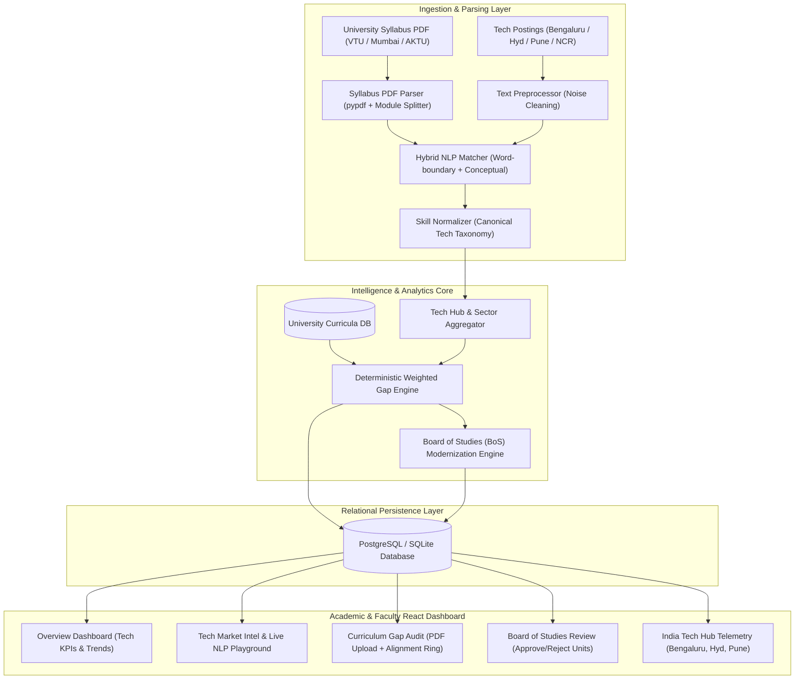

# SkillPulse Academic – B.Tech CSE Curriculum & Tech Talent Intelligence Platform

<p align="center">
  <strong>AI-Powered Engineering Syllabus Audit, Skill Gap Detection & Tech Hiring Intelligence</strong><br>
  <em>Aligning University B.Tech Computer Science Syllabi (VTU, Mumbai Univ, SPPU, AKTU) with Real-World Industry Requirements across India's Premier Tech Hubs.</em>
</p>

<p align="center">
  
  
  
  
  
  
</p>

---

## 1. Executive Summary & Problem Context

In Indian engineering universities (VTU, Mumbai University, SPPU Pune, AKTU, JNTU, and autonomous institutes), academic curricula are revised on multi-year cycles. Conversely, software industry stacks evolve quarterly—driven by rapid shifts toward cloud-native microservices, containerization, asynchronous architectures, and Generative AI / LLM engineering.

This creates a critical employability deficit:
1. **Curriculum Lag:** Syllabi emphasize theoretical models while tech companies search for Docker, Kubernetes, Next.js, FastAPI, Redis, Kafka, and RAG systems.
2. **The "Black Box" Gap:** Board of Studies (BoS) faculty lack mathematical, explainable metrics identifying *which exact topics and lab exercises* are missing from their courses.
3. **Spatial Demand Mismatch:** Software hiring stacks vary by city (e.g., High-Throughput Microservices & GenAI in Bengaluru vs. Enterprise Cloud in Hyderabad vs. Product Consulting in Pune). Engineering colleges lack localized telemetry to guide department electives.

### The Solution: SkillPulse Academic
**SkillPulse Academic** is an end-to-end curriculum intelligence and talent readiness platform:
* **Automated Syllabus PDF Parser:** Ingests official university syllabus PDFs, extracts Course Outcomes (COs) and module outlines, and auto-populates taught competencies.
* **Hybrid Skill Extraction:** Combines word-boundary regex matching with conceptual semantic patterns.
* **Deterministic Weighted Gap Scoring:** Computes exact, mathematical alignment percentages for any university course vs. industry benchmarks.
* **Board of Studies (BoS) Modernization Hub:** Formulates modular syllabus modernization units with measurable Bloom's learning outcomes, practical lab exercises, and one-click faculty endorsement.
* **India Tech Hub Telemetry:** Compares hiring volume and tech stack preferences across Bengaluru, Hyderabad, Pune, Gurugram, Noida, Chennai, and Mumbai.

$$\text{Tech Postings} \longrightarrow \text{Syllabus PDF Ingestion} \longrightarrow \text{Hybrid Gap Engine} \longrightarrow \text{BoS Modernization} \longrightarrow \text{Tech Hub Telemetry}$$

---

## 2. System Architecture



---

## 3. Key Functional Capabilities

### A. Automated University Syllabus PDF Parser (`POST /api/v1/courses/import-pdf`)
* Allows faculty and students to upload official university syllabus PDFs.
* Automatically extracts Course Codes (e.g. `BCS501`, `CSC602`), Course Outcomes (`CO1`, `CO2`), and module topics.
* Runs hybrid skill extraction across syllabus text to instantly populate the `CourseSkill` database.

### B. Hybrid Skill Extraction & Tech Taxonomy
* **Strict Word-Boundary Regex:** Eliminates false positives (`C` vs `CSS`, `Go` vs `Good`, `Java` vs `JavaScript`).
* **Conceptual Semantic Mapping:** Maps academic textbook phrasing to industry competencies:
  * *"Distributed consensus, virtualization, hypervisor"* $\to$ **Cloud Computing & Distributed Systems**
  * *"ACID transactions, B+ trees, relational algebra, 3NF"* $\to$ **Database Management Systems**
  * *"TCP/IP stack, sliding window, routing, socket programming"* $\to$ **Computer Networks**
  * *"Process synchronization, virtual memory, paging, deadlock"* $\to$ **Operating Systems**
  * *"Supervised regression, gradient descent, backpropagation"* $\to$ **Machine Learning**
* **Canonical Software Taxonomy:** Maps modern software tools (`Next.js`, `FastAPI`, `Docker`, `Kubernetes`, `PostgreSQL`, `Kafka`, `Redis`, `PyTorch`, `Generative AI & LLMs`, `RAG Systems`).

### C. Deterministic Weighted Skill Gap Analysis
* Mathematical Alignment Score:
  $$\text{Skill Alignment Score} = \left(\frac{\sum \text{Covered Weighted Points}}{\sum \text{Total Required Weighted Points}}\right) \times 100$$
* Competency breakdown into **Covered** (100% weight), **Partially Covered** (50% weight), and **Missing** (0% weight).

### D. Board of Studies (BoS) Modernization Portal
* Auto-synthesizes ready-to-adopt syllabus units for detected gaps.
* Formulates measurable **Course Outcomes (COs)**, hands-on **Laboratory Exercises**, and **Market Evidence Rationale**.
* Provides faculty endorsement actions: **Approve (BoS)** or **Archive / Reject**.

### E. India Tech Hub Hiring Telemetry
* Analyzes software engineering job postings across Bengaluru, Hyderabad, Pune, Gurugram, Noida, Chennai, and Mumbai.
* Provides city-level stack preferences to guide elective planning and placement training.

---

## 4. REST API Reference

| Method | Endpoint | Description |
|---|---|---|
| `GET` | `/api/v1/health` | Live engine and database connectivity healthcheck |
| `GET` | `/api/v1/analytics/overview` | Platform-level KPIs (jobs, unique skills, tech hub coverage) |
| `GET` | `/api/v1/analytics/skills` | Skill-demand counts categorized by tech domain |
| `GET` | `/api/v1/analytics/districts` | Spatial demand across Indian Tech Hubs (Bengaluru, Hyd, Pune, etc.) |
| `POST` | `/api/v1/jobs/import` | Ingest tech job dataset from CSV |
| `GET` | `/api/v1/jobs` | Retrieve paginated tech postings (filter by `sector`, `district_id`) |
| `GET` | `/api/v1/skills` | Retrieve canonical software taxonomy |
| `POST` | `/api/v1/skills/extract` | Extract canonical tech skills on-the-fly from unstructured text |
| `GET` | `/api/v1/courses` | Retrieve university syllabi with covered competencies |
| `POST` | `/api/v1/courses` | Manually register course syllabus |
| `POST` | `/api/v1/courses/import-pdf` | **Upload university syllabus PDF** for automated parsing & mapping |
| `POST` | `/api/v1/analysis/skill-gap` | Compute weighted skill alignment score for course vs. role |
| `GET` | `/api/v1/analysis/{id}` | Retrieve historical gap audit report |
| `GET` | `/api/v1/recommendations` | Retrieve BoS modernization proposals (filter by `status`, `course_id`) |
| `PATCH`| `/api/v1/recommendations/{id}`| Update BoS approval status (`PENDING`, `APPROVED`, `REJECTED`) |

---

## 5. Local Setup & Quick Start

### Prerequisites
* **Python:** 3.12 or higher (`uv` recommended)
* **Node.js:** v18 or higher with `npm`
* **Git:** Installed and in PATH

### 1. Clone the Repository
```bash
git clone https://github.com/LIKHIT123498/SkillPulse-Workforce-Intelligence-Platform.git
cd SkillPulse-Workforce-Intelligence-Platform
```

### 2. Backend Setup (FastAPI)
```powershell
cd backend
$env:PYTHONPATH="."
uv run python -m app.database.seed
uv run uvicorn app.main:app --reload --port 8000
```
* Interactive Swagger API Docs: [http://localhost:8000/docs](http://localhost:8000/docs)
* Healthcheck Endpoint: [http://localhost:8000/api/v1/health](http://localhost:8000/api/v1/health)

### 3. Frontend Setup (React 19 + Vite)
```powershell
cd frontend
npm install
npm run dev
```
* Web Application UI: [http://localhost:5173](http://localhost:5173)

---

## 6. Automated Verification Suite

Run all automated test suites covering syllabus ingestion, hybrid NLP, gap scoring, and BoS approvals:

```powershell
cd backend
$env:PYTHONPATH="."

uv run python tests/test_step2.py
uv run python tests/test_nlp_pipeline.py
uv run python tests/test_step4_gap_analysis.py
```

---

## 7. Demonstration Walkthrough (3 Minutes)

1. **Verify Live Status:** Open the UI at [http://localhost:5173](http://localhost:5173). The top-right badge will show **"Engine Connected"**.
2. **Review Tech Market Intel:** Inspect software engineering demand across Indian tech hubs (Bengaluru, Hyderabad, Pune, Gurugram). Paste any syllabus module into the **Live NLP Skill Extraction Playground** to see skills extracted with confidence scores.
3. **Upload or Select Syllabus:** Go to the **Curriculum Gap Audit** tab. Either click **Upload Syllabus PDF** to parse an official PDF or select an existing university scheme (*e.g., "VTU 2022 Scheme - BCS501: Software Engineering"*).
4. **Run Benchmark Audit:** Select target role *"Senior Backend Engineer (Bengaluru)"* and click **Generate Syllabus Gap Audit**.
5. **Inspect Alignment Gauge:** Review the calculated alignment score and the 3-column breakdown:
   * *Covered in Syllabus:* `Object-Oriented Programming`, `Software Testing`, `Agile Methodologies`, `Git`
   * *Industry Gaps:* `Docker`, `FastAPI`, `PostgreSQL`, `Redis`, `Kafka`, `System Design & Microservices`
6. **Board of Studies (BoS) Endorsement:** Navigate to **Board of Studies (BoS)**. Review the proposed *Applied Containerization & Docker Lab* module with specific measurable outcomes. Click **Approve (BoS)** to officially endorse the curriculum upgrade.
7. **India Tech Hub Telemetry:** Inspect the **India Tech Hubs** tab to observe city-level hiring specialization across Bengaluru, Hyderabad, Pune, Gurugram, and Chennai.
